# Esencja restaurant - table reservation system

[Polski](README.md) · **English**

> Menu, an interactive floor plan and a guest panel for a fine dining restaurant in Warsaw.

Esencja is a website for a restaurant on Krakowskie Przedmieście combined with booking a specific table. The guest
browses the menu, picks a date and time, then clicks a free table on the floor plan - from a table for two by the
window to an eight-person table in the VIP room. After creating an account they get a panel with reservations,
favorite dishes, ratings and deposit history.

It is a single-page React 19 + TypeScript app, built with Vite and styled with Tailwind CSS 4. There is no backend:
accounts, reservations and ratings are stored in the browser's `localStorage`. It is a prototype ready to show a
client and to connect to an API - not a production system (details below).

The app is in Polish.

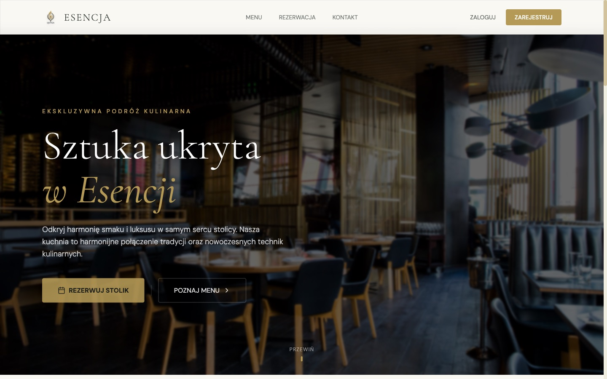

## Who it is for

- **Restaurant guests** - a menu with photos and prices, checking which tables are free at a given time, choosing a
  specific seat on the floor plan and booking without calling. You can book as a guest or with an account.
- **The owner and staff** - a ready frontend that shows how table booking could look at their place: the floor plan
  reflects the zones (main room, VIP, cloakroom, restrooms), and the deposit and visit length rules are in one file.
- **Developers** - a readable base for a real system: one component per view, data types in one place and documented
  endpoints that will replace `localStorage` ([`docs/documentation.pdf`](docs/documentation.pdf)).

What Esencja **is not**: it is not yet a system the restaurant can take bookings with. Reservations are visible only in
the browser where they were made, and deposit payments are simulated.

## How it works

```
index.html ─► main.tsx ─► App.tsx   (active view ⇄ #hash in the URL, logged-in user)
                              │
  ┌──────────┬────────────┬───┴────────┬───────────┬──────────────┐
 Hero       Menu      Reservation   ContactMap   Dashboard     Auth (modal)
 start      #menu     #rezerwacja   #kontakt     #panel        login / sign-up
             │            │                        │              │
             └────────────┴────── localStorage ────┴──────────────┘
```

**Views** switch without a page reload, and each has its own address (`#menu`, `#rezerwacja`…), so the Back button,
refresh and direct links work. `#panel` without logging in goes to the start page and opens the login.

**Data** lives in `localStorage` under the keys `user_{email}`, `esencja_all_reservations`, `reservations_{email}`,
`history_{email}`, `favs_{email}` and `ratings_{email}` - each key is fully described with examples in the technical
documentation.

**A reservation** goes like this:

1. The guest picks a date (from today) and a time (12:00-21:00, for today only times that haven't passed yet). Until
   then the floor plan is covered.
2. The plan marks tables taken at the chosen time in red. The whole visit window counts: a table booked at 19:00 for
   2 hours is taken at 19:00 and 20:00, and free at 21:00.
3. Clicking a free table (or Enter on the keyboard) opens a form: full name, phone, email, duration (1.5-3 h), number
   of guests and notes. A logged-in user's details are prefilled.
4. Before saving, the app checks for conflicts again - if the table was taken in another tab, it shows an error.
5. A reservation from an account adds a PLN 50 per person deposit to the history. A guest gets a nudge to create an
   account.
6. In the panel a reservation can be cancelled (with confirmation) - the deposit is refunded in the same amount.

## Features

**Public site**

| Path | What it is |
|---|---|
| `/` | Hero, kitchen philosophy, featured dishes, guest review carousel |
| `/#menu` | 11 dishes in 4 categories with a filter, "Chef recommends" badges, favorites and 1-5 ratings after logging in |
| `/#rezerwacja` | SVG floor plan (8 tables for 2-8 people, VIP room), live availability, reservation form |
| `/#kontakt` | Address, phone, email, Google map and a "Navigate to the restaurant" button |

**Guest panel `/#panel`**

- **My reservations** - date, table, number of guests, duration, notes, cancellation with a deposit refund.
- **Favorite dishes** - dishes marked with a heart in the menu, removable.
- **My ratings** - given stars, removable.
- **Transaction history** - deposits and refunds with an ID, amount, date and status.

**Account** - sign-up (name, email, phone, password of at least 6 characters), login with email or username, logout.
Phone validation accepts `500600700`, `500 600 700` and `+48 500 600 700`.

## Screenshots

### Public site

| Kitchen philosophy | Featured dishes |
|---|---|
| 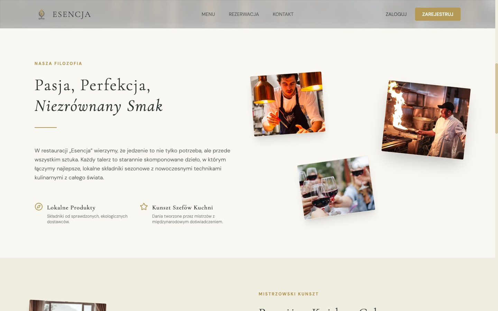 | 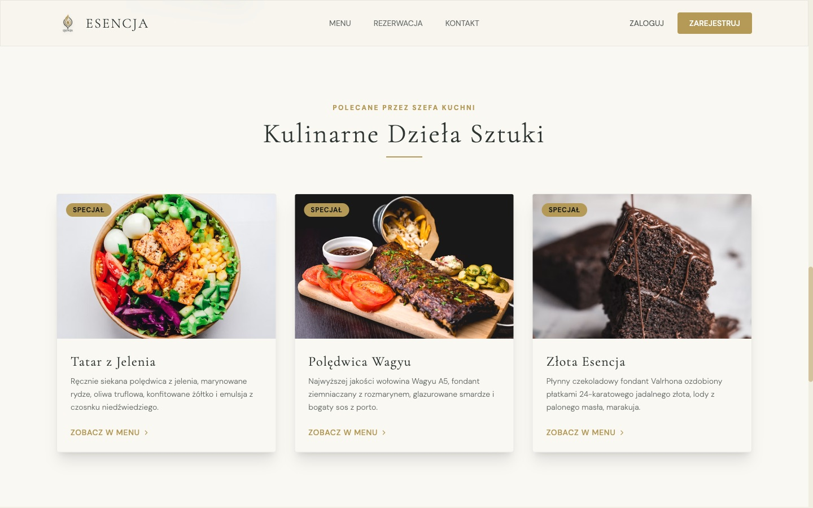 |

| Menu | Contact |
|---|---|
| 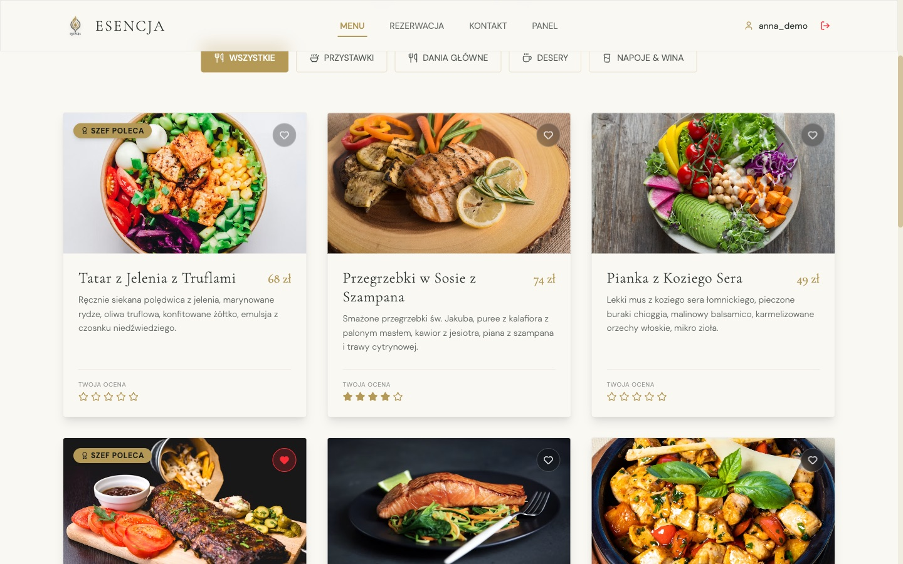 | 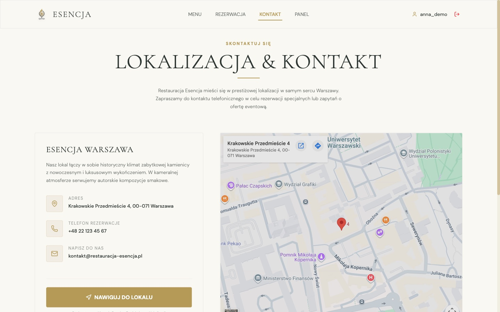 |

### Reservation

| Floor plan before choosing a time | Table selection and form |
|---|---|
| 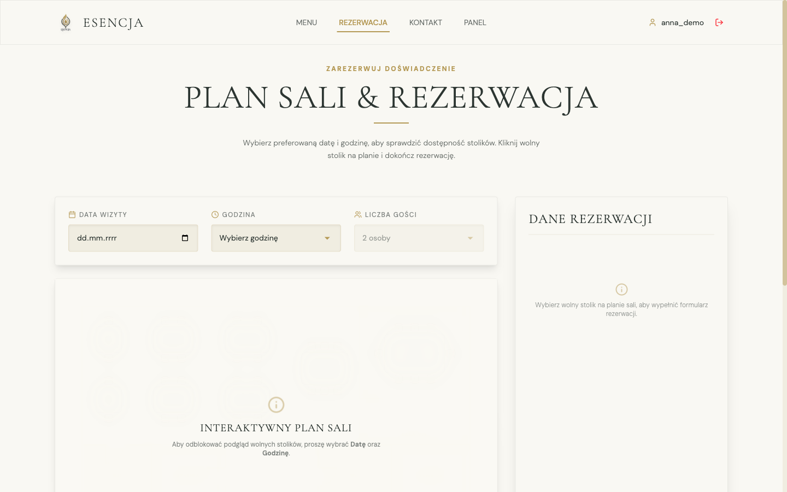 | 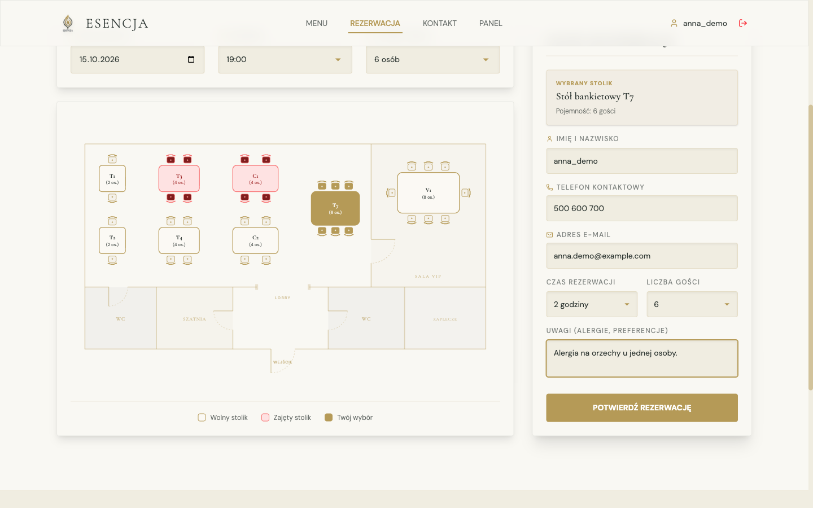 |

| Confirmation | Sign-up |
|---|---|
| 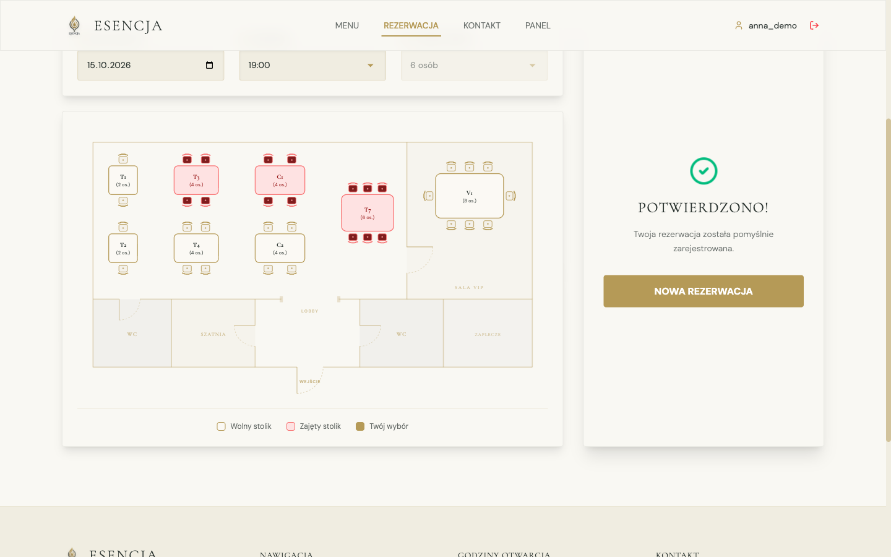 | 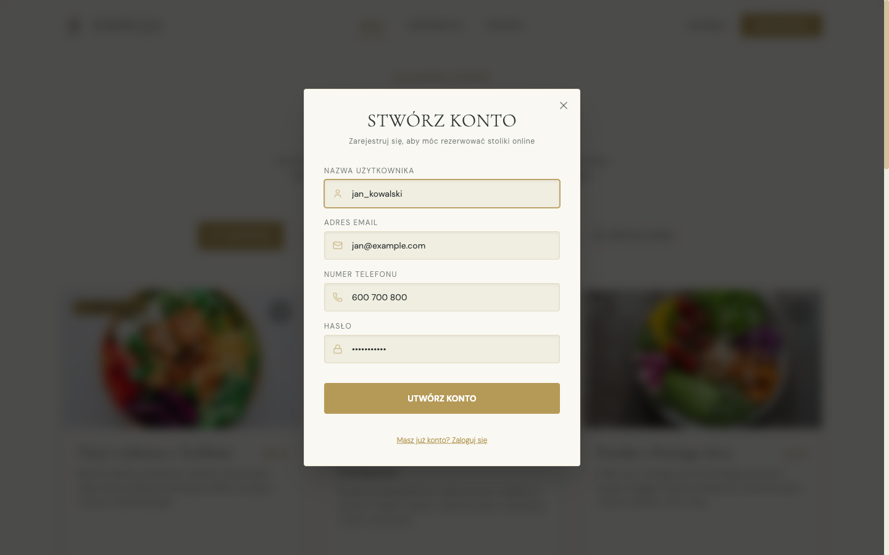 |

### Guest panel

| My reservations | Favorite dishes |
|---|---|
| 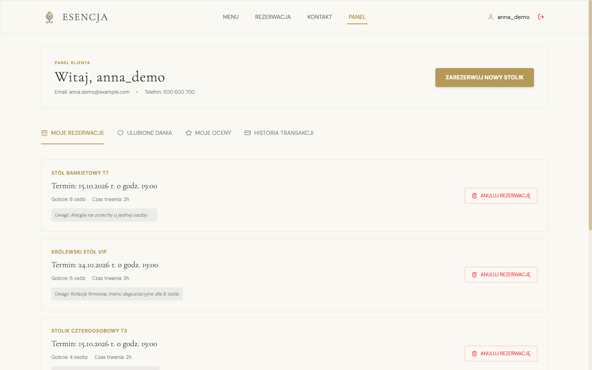 | 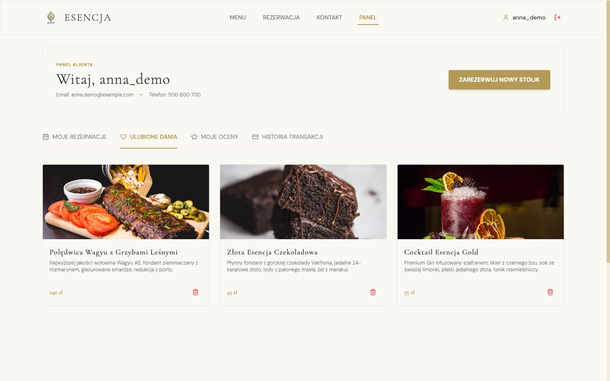 |

| My ratings | Transaction history |
|---|---|
| 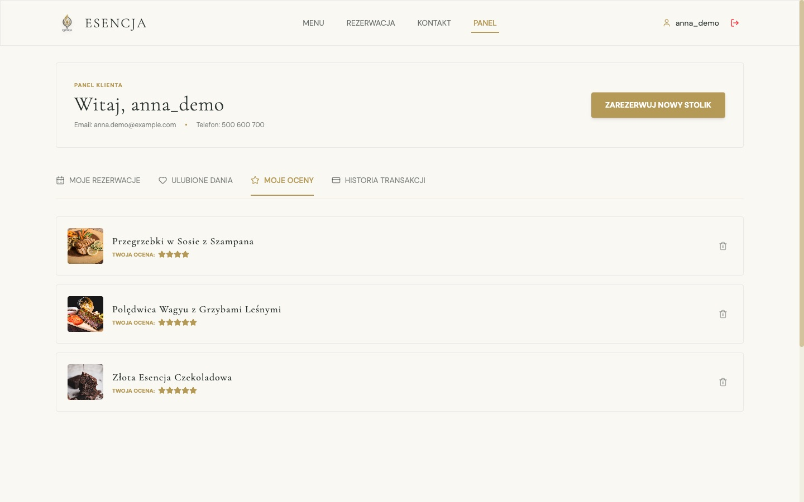 | 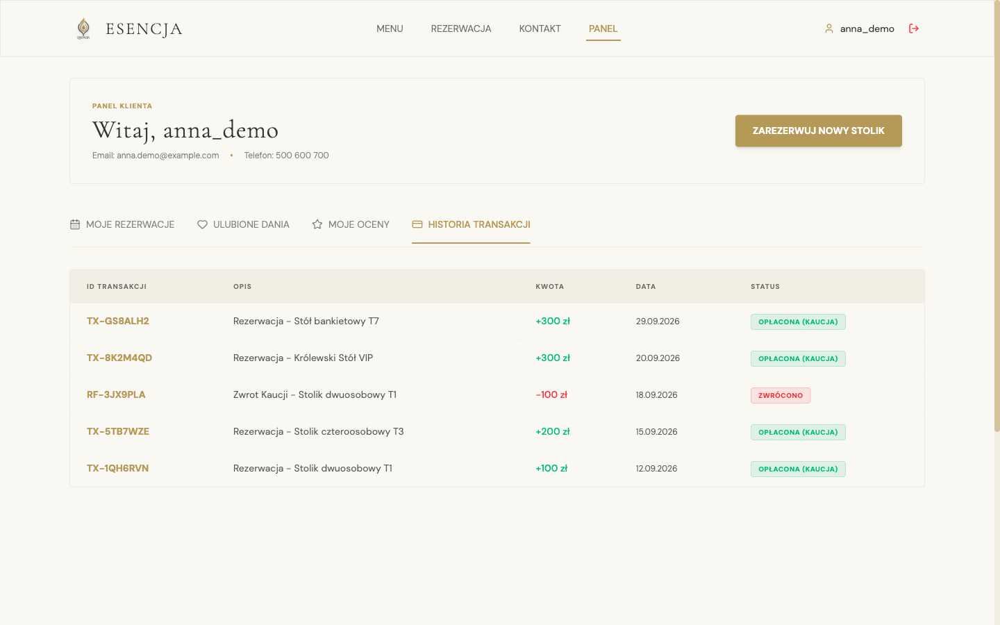 |

### Phone

| Home page | Floor plan | Navigation menu |
|---|---|---|
| 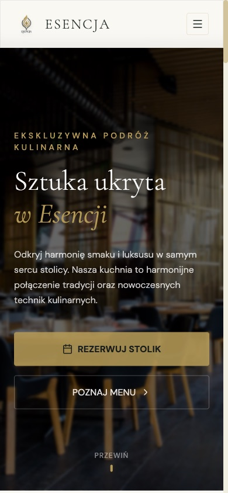 | 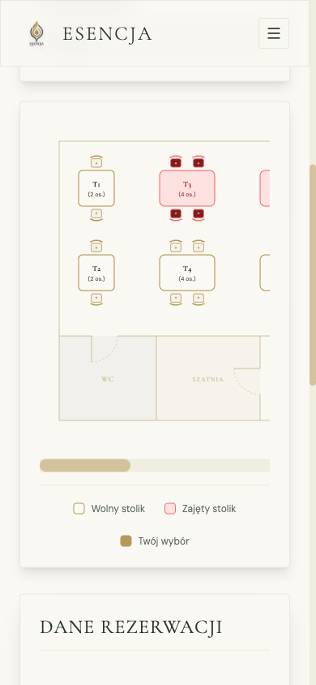 | 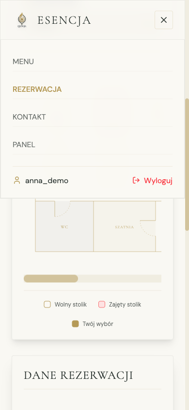 |

Accounts, reservations and transactions in the screenshots are sample data.

## Getting started

Requires Node.js 20.19+ or 22.12+ (a Vite 8 requirement).

```bash
npm install
npm run dev        # http://localhost:5173
```

The app needs no `.env` file, API keys or database - everything works right after installing. To start from scratch,
clear the site data in the browser (DevTools → Application → Local Storage).

| Script | What it does |
|---|---|
| `npm run dev` | Vite dev server with HMR |
| `npm run build` | Type check (`tsc -b`) and production build to `dist/` |
| `npm run preview` | Preview of the built version |
| `npm run lint` | Lint with oxlint |

### Deployment

`dist/` is static files - any static hosting works (Vercel, Netlify, GitHub Pages, nginx). Routing is based on
`#hash`, so the server needs no rewrite rules.

## Structure

```
src/
  App.tsx                  views, hash routing, user session
  components/
    Navbar.tsx, Footer.tsx navigation (desktop + mobile), opening hours, contact
    Hero.tsx               start page, reviews, featured dishes
    Menu.tsx               menu, favorites, ratings
    Reservation.tsx        floor plan (SVG), availability, form, deposit
    Dashboard.tsx          guest panel
    Auth.tsx               login and sign-up modal
    ContactMap.tsx         contact and map
    BlurText.tsx, ScrollReveal.tsx   text animations
  data/menuData.ts         menu items
  types/index.ts           Dish, Reservation, User types
  utils/validation.ts      phone and email validation
  index.css                color and font tokens (Tailwind @theme)
public/                    logo, icon, favicon
docs/
  documentation.pdf / .html   technical documentation and e2e test report
  screenshots/                screenshots used in the README
LICENSE                    MIT license
```

## Design

The "Light Velvet Cream / Gold" palette: cream background `#F9F8F3`, gold `#B59A57`, dark green `#2C3531`. Headings in
Cormorant Garamond, body text in DM Sans. The site has a light theme only, regardless of system settings. Animations
(Framer Motion, GSAP) respect the "reduce motion" setting.

## Security and limitations

This is a frontend prototype. Before taking the first real reservation you need a backend:

- **Passwords are stored in `localStorage` as plain text.** Any script on the page and anyone with access to the
  browser can read them. Don't use real passwords.
- **Reservations never leave the browser.** The restaurant doesn't receive them, and two different devices can book
  the same table.
- **Payments are simulated** - there is no payment gateway and no real deposits.
- There is no email verification or password reset.

The minimal API that will replace `localStorage` (sign-up, login, availability, reservations, favorites, ratings) is
described in [`docs/documentation.pdf`](docs/documentation.pdf) in the "Security and limitations" section.

## Performance

Production build: JS 538 kB (173 kB gzip), CSS 45 kB (8 kB gzip). Most of it is animation libraries (Framer Motion,
GSAP) and confetti - the first place to optimize. Dish and interior photos are loaded from Unsplash at 600-800 px wide.

## Before publishing

- **Awards and reviews** - the "Master craftsmanship" section shows "Michelin Guide - Recommendation 2026" and
  "Champion de Qualité", and the carousel contains named guest reviews. Keep only real awards and reviews, Michelin
  is a trademark.
- **Dish photos** come from Unsplash and not all of them match the descriptions (e.g. the venison tartare shows a bowl
  of tofu). It is best to replace them with your own photos.
- **External content** - Google Fonts, Google Maps and Unsplash photos are loaded from external servers, include this
  in the privacy policy (GDPR).

## Documentation

- [`docs/documentation.pdf`](docs/documentation.pdf) (and the [HTML](docs/documentation.html) version) - architecture,
  views, the `localStorage` data model with examples, reservation rules, the menu, limitations, a proposed API, an
  e2e test report with a list of fixes and to-dos, and repository rules and license (Polish).

## License

The project is released under the MIT license. See [`LICENSE`](LICENSE) for details.
